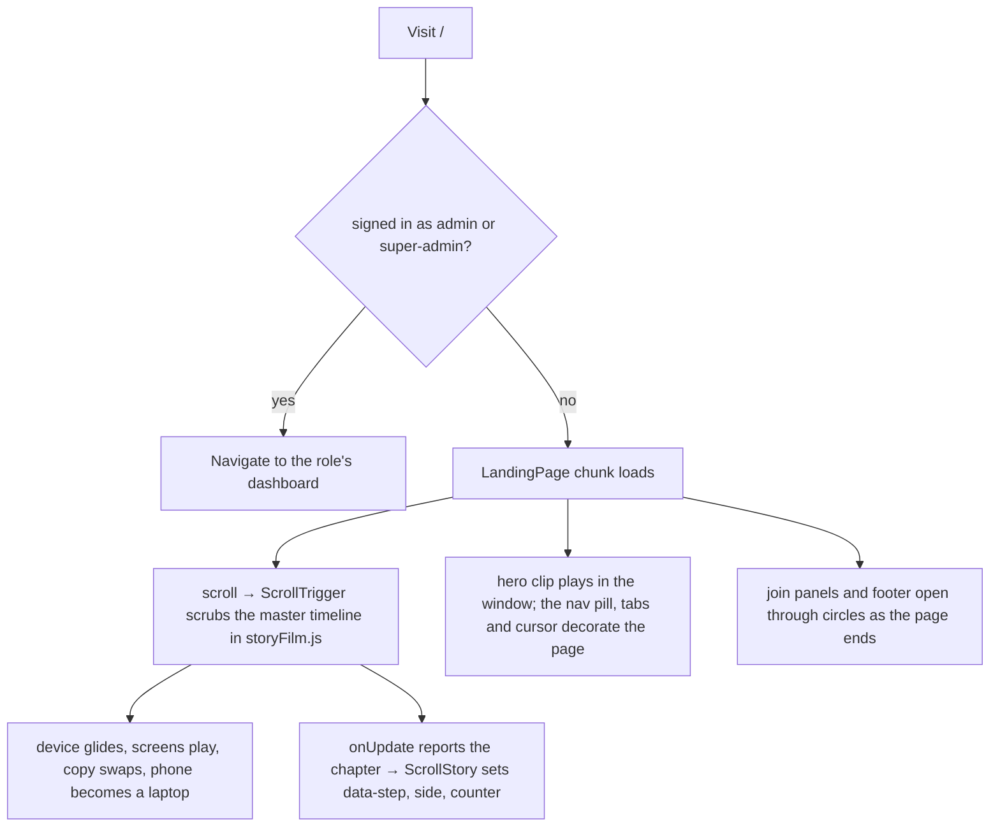

# LANDING — Web Admin

> **Brand:** the public site is called **Pingo** (it was TrackMe). The manager portal behind `/login` and the real captures of it in `public/landing/portal-*.jpg` still say TrackMe until the portal itself is renamed; re-take the captures then.

The public marketing page at `/`: what TrackMe is, how it works for riders and fleet managers, and
where a rider or a driver goes next.

**Status:** `IN-PROGRESS` — built and tested, but three things need an owner before launch: confirming
the hero footage may be used (it shows a real operator's branded bus; §6), the live download links (needs the app-releases backend deployed, `VITE_API_URL` set
in Vercel, and Git LFS enabled there — see [`APP_RELEASES.md`](APP_RELEASES.md)), and an agreed backend
endpoint for the driver email form (§4).

**Role:** none. It is public and signed-out only. A visitor already signed in as a manager or
super-admin is redirected to their dashboard before the page renders (`LandingGate` in `App.jsx`).

---

## 1. Purpose

Give a first-time visitor a reason to care in one screen, then route them: riders to the app,
drivers to an email form, fleet managers to `/login`. It makes **no backend calls** today.

The hard constraint is honesty: no invented statistics, ratings, user counts or testimonials. Every
claim describes a feature that exists (live tracking, enrollment keys with manager approval, fleet
management, custom routes). The phone screens are illustrative and say nothing about real data.

**The look** is deliberately editorial, not a template: big confident type, very little copy, sunlit
paper (`bone`) against deep blue-green `ink` and a flat `sky` blue panel, a single mint (`teal`) reserved
for live things, and motion that means something (a sentence that lights up as you read, a
shuttle that rides the page). The palette is drawn from the hero film: `ink` from the shaded foliage and
the sky's shadow, `bone` from the sunlit road edge, `sky` from the sky darkened until type can sit on it,
`teal` as the colour between that sky and the grass. Sections meet on **tabs** (a soft step down in the
middle of the edge, see `TabEdge`), not straight lines. It was rebuilt after the first version was called
out as looking AI-made. The tells to avoid: glow blobs, frosted-glass *cards*, gradient text,
icon-in-a-box grids, and paragraphs of copy. (The one glass element is the floating nav pill, on purpose.)

## 2. Key files (one job each)

| File | Responsibility |
|---|---|
| `src/App.jsx` | `LandingGate` + the public `/` route. Lazy-loads the page so the portal bundle never pays for it; redirects signed-in managers/super-admins. |
| `src/pages/landing/LandingPage.jsx` | Composes the sections, sets the document title, wraps everything in `dark` so the Atlas dark tokens apply whatever theme the portal last used. |
| `src/pages/landing/config.js` | **All copy and external links**: `HERO_VIDEO` (the wide and tall HD clips: file, poster, still, size and focus), `APP_LINKS`, `PRIVACY_URL`, nav, the one `STATEMENT` sentence, the three `POINTS`, the four `STORY` steps, the portal screenshots. Edit here, not in components. |
| `src/pages/landing/Hero.jsx` | **The hero is the word PINGO with the film showing through its letters, played by scrolling.** At rest (after the opening loader, or straight away for a returning visitor) the page is only the nav, the thin frame and the word. **The word drops in** from above the screen over about 3.6 seconds, smooth with no bounce, starting big and close (`--wd`) and settling to its size as it lands (`ready` comes from `LandingPage` once the loader is done). The film is **masked by the word**: `.l-hero-window` carries a data-URI SVG mask of the letters P I N G O, drawn in code with strokes 24 units thick (`--word`, 470 x 100 units; no font needed), sized by `--ws` and placed by `--dy`, with a second mask layer, a circle growing from the middle (`--wc`), joined to it. The stage is pinned (ScrollTrigger, `scrub: 1.2`) for `HERO_SCROLL_SCREENS` (4.6, and 3.6 on a phone) screens: the word grows (`--ws` 1 to 5, slow at first so the letters stay readable), a circle of film opens from the middle while they are still readable (`--wc`, from 12% of the film) and finishes the screen, the frame and the scroll cue fade, a dark veil comes in, and only then do the words arrive: the question rises in, the buttons and the drifting Schools, Campuses, Offices words fade up, the question lifts away and the answer "Right here." rises in from behind masks. **The buttons are hidden at rest** (the nav keeps "Get the app" on the first screen) and fade up with the film; they are always in the page for keyboard and screen-reader users. On a phone the same one-line word takes 94% of the width. For reduced motion it renders the finished frame (`data-hero-state="static"`, the stylesheet removes the mask). Inside the window it plays the film clip (`HeroFilm`) when `HERO_VIDEO` is set, otherwise the coded `NightRoad`. The clip is never slid (the word spans the screen, so its own edge would show through the letters); the scene pushes in a little (`HERO_VIDEO_PUSH`). |
| `src/pages/landing/curtain.js` | **The curtain**: a pinned scene (the hero, the story) stays put for one more stretch of scrolling (`CURTAIN_SCREENS`: 1 screen, 0.8 on a phone) while the next section slides up over it, and the pinned scene recedes (scale 0.92, corners rounding to 28px, dimming to 72%) as it is covered. Mechanics: the scene's pin is made longer by the curtain's length, and the next section pulls itself up by exactly that much with a negative top margin read from a CSS variable (`--l-curtain-hero`, `--l-curtain-story`) that the pin's `end()` function sets (`declareCurtain`) and a cleanup removes (`clearCurtain`), so a stale length never outlives its pin. Pure parts: `curtainScreens`, `curtainUnits`, `sceneProgress`, `risesOver`, `RECEDE`. |
| `src/pages/landing/HeroFilm.jsx` / `heroVideo.js` | **The film clip.** `HeroFilm` is a muted, looping, inline `<video>` (poster while it loads) that pauses when the hero is off screen; for reduced motion it is just a still ``. It sits at its *full covered size* on the stage (not `object-fit: cover`) so what a phone's crop throws away can still be slid into view. `heroVideo.js` is the pure geometry: `coverGeometry`, `focusOnStage`, `sceneShift` (how far to slide the scene so the clip's subject is under the window, clamped so the clip's own edge never enters the circle), `pickClip` (the portrait cut for an upright screen, the wide 1080p one for everything else). |
| `src/pages/landing/NightRoad.jsx` / `roadScene.js` | **The hero's fallback picture, drawn live in code** (used when `HERO_VIDEO` is `null`): a night road in perspective with a skyline, streaming lane lines, passing lamps, oncoming headlights and a shuttle with a tracking reticle ("SHUTTLE A · LIVE"). `roadScene.js` is the pure maths (projection, depth looping, the shuttle's box, the skyline, and `heroWindow()`: where the opening window sits and how big it must grow to cover the screen); `NightRoad.jsx` turns it into canvas pixels. The road rushes faster when the visitor scrolls fast (`speedRef`, raised by the hero from scroll velocity). Original artwork, no assets, a few KB. Pauses off screen and in a hidden tab; one still frame under reduced motion. |
| `src/pages/landing/WhatSection.jsx` / `ScrubText.jsx` / `scrub.js` | The paper-coloured break after the hero: one big sentence that lights up word by word as it scrolls through the reading zone, then the three points as a **measured grid**: hairline cells with crosshairs (`GridMarks.jsx`) where the lines meet, a small drawing in each cell (`PointArt.jsx`: a shuttle driving a route, a driver key with its approval, a fleet's progress bars) and a cell that turns ink-dark as the pointer rests on it. It **rises over the pinned hero like a curtain** (see `curtain.js`). The words are always real text in the DOM; only opacity moves. |
| `src/pages/landing/TabEdge.jsx` | **The seam between two sections**: put first inside the section *below* (which is `relative`), tinted with the colour of the section *above* (`tone`: ink, bone or sky). Two mirror-image S-shaped shoulders and a flat middle, 14%-86% of the width on a wide screen (5%-95% on a phone), 32px deep (20px on a phone), drawn over the top of the lower section. **It flattens as the section arrives**: scrubbed `scaleY` 1 to 0 from the section's top entering the screen to `flattenBy` (default `top 12%`), so the seam ends as a straight line. Because it lives in the lower section it never moves with a pinned scene above. Decorative (`aria-hidden`). Used four times: ink over the paper section, paper over the story, ink over the join section, paper over the footer. |
| `src/pages/landing/LandingNav.jsx` | **The floating pill**: centred, blurred, fully rounded (max 38rem), with a glint of mint running round its 1px edge (`.l-nav-glint`, an animated `@property --l-angle` conic gradient; a browser without `@property` just shows the plain hairline). Inside: the "P" mark (a rounded square tile, like an app icon) with a pulsing live dot and the name "Pingo" (on a phone narrower than 360px only the mark shows; the name stays for assistive tech), the section link "How it works" with a scroll-spy capsule (md+), four ticks that stretch and light up for the section you are in (md+), and the one filled button, **"Get the app"** (`#join`). A thin line along the bottom edge fills with the page's scroll (`data-nav-progress`, written straight to the element). The pill **slides up out of view on the way down and returns on the way up** (always shown within 120px of the top or while the menu is open). **"Manager portal"** (md+, outlined, beside the button) and **"Visit manager portal"** (last item of the phone menu) both link to `/manager/dashboard`: a signed-in manager lands on their dashboard, anyone else is bounced to `/login`. The footer keeps its own "Manager sign in". On a phone a round menu button opens a **full-screen menu out of its own corner** (`#landing-menu`, a `clip-path` circle growing from the button, big numbered links that rise in one after another; closed it is `invisible` and its links are out of the tab order; Escape, choosing a link, or growing past `md` closes it; it carries `data-lenis-prevent` and `touch-none` so the page behind does not scroll). |
| `src/pages/landing/Footer.jsx` | **The finale** (the wordmark now reads **Pingo**; a paper tab hangs over its top edge and the filled word's clip-path has room above and below so the tail of the "g" shows): as the footer scrolls in, a circle of sky opens from its bottom edge (`--r`, scrubbed) and the giant wordmark fills in left to right (`clip-path`), both finished exactly at the very bottom of the page on any screen. Reduced motion: just finished (sky, filled wordmark). |
| `src/pages/landing/Cursor.jsx` | A ring that trails the mouse and swells over anything pressable, with a dot under the pointer. Mouse only (`pointer: fine`) and never for reduced motion; the real cursor is never hidden and it never takes a click. |
| `src/pages/landing/ScrollStory.jsx` | **"How it works", the main section.** Unless the visitor prefers reduced motion it renders the pinned stage on every screen size (`PinnedStory`). Wide (`lg`+): a half-width device column (a phone holding three stacked screens, and a laptop beside it), one block of copy per chapter on the opposite side, a giant outlined chapter number behind each, and a progress bar per chapter. **Compact (a phone or tablet, below 1024px)**: the same stage with the device centred in the whole width *above* its copy, no giant numbers, the copy bottom-aligned and the progress bar at the foot; the phone is drawn at a fixed 246px (`CompactPhone`) and scaled down as a picture when the screen is short or narrow, never squeezed (its screens are drawn for that width and would re-wrap). React only renders where everything *starts* and follows the film's chapter (`data-step`, `data-side`, the counter, `aria-hidden` on the copy not on show); it never moves the pieces. For reduced motion it renders `StackedStory`: plain chapters in a column, phones tilted in alternating directions in CSS (alternating rows from `lg` up). |
| `src/pages/landing/storyFilm.js` | **The film itself.** `buildStoryFilm` pins the stage for `storyScreens(width)` screens (6.5 wide, 4.8 on a phone) and builds one master GSAP timeline, 0 to `CHAPTERS` (4), scrubbed by scroll (`STORY_SCRUB` 1): each chapter's screen plays, then across the boundary the device glides (to the other side, or with `sideX = SIDE_X_COMPACT` a gentle sway), the old copy lifts away, the screen changes and the new title rises from behind its word masks; at the last boundary the phone dissolves into a laptop. Its trigger has `refreshPriority: 1` (see §6). `detached: true` builds the same timeline paused and without ScrollTrigger, for tests. |
| `src/pages/landing/chapterMath.js` | The film's numbers, pure: the timeline layout (`CHAPTERS`, `GLIDE`, where each chapter's content starts and how long it runs, `SIDE_X`, and for a phone `SIDE_X_COMPACT` and `storyScreens(width)`), and the rules for what each screen shows at a moment (`etaMinutes`, `stopsAway`, `STOP_FRACTIONS`, `keyReveal`, `enrollStatus`, `profileEtaMinutes`, `chapterCounter`). |
| `src/pages/landing/story.js` | Pure chapter maths: `stepFromProgress`, `sideForStep`. |
| `src/pages/landing/DeviceFrames.jsx` | `PhoneFrame`, `LaptopFrame` bezels. |
| `src/pages/landing/screens/*.jsx` | `MapScreen`, `EnrollScreen`, `ProfilesScreen` (code-built phone UIs) and `PortalScreen` (real captures of the manager portal, plus an "approved" toast). Each rests on its **finished** state, so a static render (reduced motion, a phone's stacked list, jsdom) is already complete. They never import GSAP. |
| `src/pages/landing/screens/{map,enroll,profiles,portal}.js` | Each screen's **scene**: a pure `paint…(root, progress)` that writes the screen as it is at that moment of its chapter (the shuttle on the route with the driven part lit, stops lighting as it passes, the ETA falling; the key typed one character at a time, the request sent, then "waiting for approval"; riders arriving and the second shuttle closing in), and a `play…(tl, root, at, span)` that adds it to a timeline. `play.js` holds the helpers (`setText` keeps the same text node so React is never confused; `setFlag`; `scrubbed`, which paints the opening frame at once then drives `paint` from the timeline). |
| `src/pages/landing/JoinSection.jsx` / `LeadForm.jsx` / `validation.js` | "Rider or driver?": **one drawn spread on paper**: the big question and a measured grid (hairlines, crosshairs at the corners and the joint) holding two halves side by side, each led by a big **solid sky-blue numeral** (01, 02). No eyebrow, strapline or descriptions. The rider's half is the **download area**: two store badges (iPhone, Android; each a disabled "Coming soon" badge until a real link exists) and a phone showing the live map: rising from the bottom edge on a wide screen, and on a phone (below `md`) climbing inside a sky-blue arch (`[data-arch]`, `[data-phone-rise]`) under the badges. The driver's half is the email form (`LeadForm`). **On a phone only** it plays as it arrives: the question's words rise from behind masks, the halves come up one after the other, the arch grows and the phone climbs with the scroll. There are no hover colour changes. It slides up over the pinned story like a curtain. |
| `src/pages/landing/landing.css` | Everything custom: the palette variables, reveal, grain, keyframes, outlined type, the rider/driver split, the circle wipe (`.l-wipe`) and the cursor. Scoped under `.landing`. |
| `tailwind.config.cjs` | Registers `l-ink`, `l-bone`, `l-sky`, `l-teal` as real Tailwind colours (see §6 for why this matters). |
| `src/pages/landing/motion/gsapSetup.js` | The one place GSAP and ScrollTrigger are registered and configured, plus the named `EASE` set. Only the lazy landing chunk imports it, so the portal never ships GSAP. |
| `src/pages/landing/motion/MotionProvider.jsx` / `context.js` | **Smooth, inertial scrolling (Lenis)**, driven from the GSAP ticker so ScrollTrigger stays in step, plus gliding to in-page `#anchors`. Off for reduced motion and where animation is unavailable; touch keeps native scrolling. `context.js` holds `useMotion()` (`lenis`, `reduced`, `scrollTo`) and `browserCanAnimate()`. |
| `src/pages/landing/motion/Loader.jsx` / `intro.js` | **The opening**: a route draws itself under the wordmark while a 000-100 counter runs, then the page opens through a circle growing from where the shuttle sits (the radar-ping motif). Locks scrolling while it plays, capped at `INTRO_MAX_MS` (3.6s). `intro.js` is the pure logic: when to play, the session flag, the counter format, the circle's origin. |
| `src/pages/landing/motion/useViewportSize.js` | The viewport size, updated on resize but steady through a phone's address-bar wobble (height changes under 150px are ignored), so pinned scenes are not re-measured and made to jump. |
| `src/pages/landing/motion/useGsapContext.js` | Runs GSAP code for a component's lifetime and reverts all of it (tweens, timelines, ScrollTriggers) on unmount. Use it for every scroll-driven scene. |
| `scripts/check-landing-budget.mjs` | `npm run check:landing-budget` after a build: fails if the landing chunk exceeds 120 KB gzipped. |
| `src/hooks/use-media-query.js` | `useMediaQuery(query)`, used to pick the compact (phone) story layout and the phone-only animations. |
| `public/landing/hero.mp4`, `hero-tall.mp4`, `hero-*.webp` | The hero clips, both cut from the 4K source: **1920x1080 at 5 Mbps (9 MB)** and a **810x1440 portrait cut at 3.4 Mbps (6 MB)** that follows the bus, each with a `poster` (the first frame, shown while it loads) and a `still` (used instead of the video for reduced motion), as WebP. See §6 for how they were made and the footage's licence/brand caveat. |
| `public/landing/portal-*.jpg` | Real captures of the manager portal in dark mode, taken from the E2E mock data (not real fleets). Re-take them if the portal's look changes. |

## 3. Data flow

None: static content. The only state is local UI state (the story's current chapter, form text).

## 4. Contracts (API / socket / storage)

| Kind | Name | Notes |
|---|---|---|
| REST | **driver email: endpoint not agreed yet** | `LeadForm` takes `onSubmit(email)`. `LandingPage` defaults it to `submitDriverInterest` (`driverInterest.js`) **only when `DRIVER_INTEREST_ENDPOINT` in `config.js` is set**; today it is `null`, so the form validates and then says plainly that nothing was sent. The request it will make is `POST <endpoint>` with `{ email, source: 'landing' }` and any 2xx = success. **That shape is a proposal, not an agreed contract**: confirm it with the backend owner, then set the endpoint, and add the backend doc + sandbox fixture per `CLAUDE.md`. Like `useAppDownloadLinks`, it calls the API directly because the form is public and signed-out. |
| REST | `GET /api/app-releases/latest` | The rider/driver store buttons in `JoinSection.jsx` now fetch live download links via `useAppDownloadLinks.js` — see [`APP_RELEASES.md`](APP_RELEASES.md) for the full contract; this file does not duplicate it. |
| External | `APP_LINKS.ios` / `.android` | `null` today — the static fallback `useAppDownloadLinks()` uses until a real release exists, at which point the buttons render disabled with "Coming soon". The Android button is labelled **"Android (APK)"** because it is a direct file download, not a Google Play listing; the iOS button is **"iPhone (iOS)"** and stays "Coming soon" until an iOS build is registered. |
| External | `PRIVACY_URL` | The published `trackme-privacy` GitHub Pages site. |

## 5. Not visible in the frontend

- The page is **always dark in its frame** by design (the root carries `dark`) and ignores the
  portal's theme toggle. The paper-coloured section is a deliberate light break inside it.
- The portal sets `overflow-x: hidden` on `html`, `body` and `#root`. That makes `#root` a scroll
  container, which silently breaks `position: sticky` and makes ScrollTrigger measure the wrong
  scroller. `landing.css` overrides it for pages that contain `.landing`. If a pinned stage ever
  scrolls away instead of pinning, look here first.
- **Scrolling is Lenis, not the browser's.** With it running, `<html>` carries the `lenis` class and
  the page's CSS `scroll-behavior: smooth` is switched off (the two would fight). Lenis still moves the
  real window scroll position, so every `scroll` listener, `position: sticky` and ScrollTrigger keep
  working unchanged.
- **The hero window is a clip-path driven by CSS variables.** `.l-hero-window` uses
  `clip-path: circle(var(--wr) at var(--wx) var(--wy))`; GSAP animates `--wr` on the stage and a ring
  element follows it. `--wx/--wy` come from `heroWindow()` (the shuttle's centre) and are re-measured when
  the viewport changes meaningfully.
- **The opening is a mask, not a clip.** `.l-loader` uses a `radial-gradient` mask whose radius is the CSS
  variable `--r`, animated by GSAP from `0%` (covered) to `112%` (gone). The hole is centred on
  `--x/--y`, set from `irisOrigin()` (the shuttle's spot in the hero).
- With `HERO_VIDEO` set the hero plays the clip under a 15% ink tint that lives on the *window* (not the
  sliding scene, or a strip beside it would go untinted), and `NightRoad` is not drawn.
- **Circle wipes are a CSS variable too.** `.l-wipe` is `clip-path: circle(var(--r, 150%) at var(--x, 50%)
  var(--y, 0%))`. GSAP scrubs `--r` from `0%`; with no animation the default `150%` means "open", so a
  static render, reduced motion and jsdom all show the finished section.

## 6. Known gotchas / open items

- **The hero footage shows a real operator's livery.** The supplied clip (a 4K, 14 s daylight shot) has
  a bus clearly marked "OMNIRIDE" with a phone number, a real US transit service. Free stock licences
  usually allow commercial use but not implying an endorsement, so **confirm the rights before launch**,
  or swap the clip (it is one object in `config.js`; `HERO_VIDEO = null` brings the coded road back).
  Keep a replacement muted, loopable, 10-20 s, H.264 MP4, ideally under ~10 MB wide and ~6 MB portrait.
- **How the clip files were made (no ffmpeg on the machine).** The 4K source is played in the system Chrome,
  slowed to a quarter speed so no frame is skipped, and each frame is read with its real timestamp, scaled
  to the target size with high-quality filtering and encoded with WebCodecs (`VideoEncoder`, H.264 High,
  variable bitrate, a keyframe every two seconds). The encoded frames are written into a plain fast-start
  MP4 by a small hand-written muxer (no B-frames, BT.709 tagged). The earlier version was a real-time
  screen recording of the playing video at 720p, which dropped frames and looked soft; this one matches the
  4K source closely at 1:1. Re-encoding means re-running that tool against the source; the numbers to keep
  are 1920x1080 at about 5 Mbps and 810x1440 at about 3.4 Mbps (4.2 Mbps visibly softened the grass).
- **The portrait cut is a virtual camera.** `hero-tall.mp4` is a 9:16 window cut from the full-height 4K
  frame, centred on the bus along a smooth path read off the clip (the bus drifts from 26% to 46% of the
  width), so an upright phone gets a sharp picture of the bus instead of a thin slice of the wide one.
  `pickClip` chooses it by the screen's shape (width over height under 0.8, so an upright tablet too); a
  phone on its side gets the wide cut. A browser with no H.264 (open-source Chromium, used by the Playwright
  tests) just keeps showing the poster.
- **`focus` in each `HERO_VIDEO` clip is where the bus is at the start**, as a 0..1 point in that
  clip's frame (wide `{ 0.27, 0.53 }`, tall `{ 0.5, 0.53 }`). The opening window is placed on it by sliding
  the scene. A different clip needs its own focus; the geometry tests cover any clip size.
- **The scene is bigger than the stage.** `HeroFilm` places the clip at its full covered size
  (`coverGeometry`) rather than using `object-fit: cover`, because the opening slides the scene and a
  cropped-away part (the bus, on a portrait phone) must still exist to slide into view. The slide is
  clamped (`sceneShift`) so the clip's own edge never enters the window; a test checks this on six screens.
- **On a phone the window is measured, not guessed.** `heroWindow(w, h, headlineTop)` puts it in the gap
  between the nav pill and the headline's real top (measured in a layout effect, re-measured when fonts
  load), no bigger than that gap. Only with a clip: the coded road's window must stay on its own shuttle.
  The hero also has short-screen variants (`[@media(max-height:700px)]`: less bottom padding, the
  description hidden) so 320x640 phones are not cramped; an e2e at four phone widths checks the window
  clears both nav and headline.
- **The nav pill hides "Manager" below 400px but keeps it for assistive tech** (`sr-only min-[400px]:
  not-sr-only`). Reading the button's visible text in a test returns the sr-only word too, so tests
  check its 1px box instead.
- **Text on the sky panel needs to be strong.** `bone/75` on `sky` is 4.1:1, under WCAG AA; the panel
  uses `bone/90` (5.3:1) and `bone/80` for the small mono numbers.
- **The story is slower on purpose.** `STORY_SCREENS` is 6.5 (1.6 screens per chapter), `GLIDE` is 0.2 (the device's glide takes 40% of a chapter), the scrub lag is 1s and the swaps use sine easing, because the swap between chapters should be watched, not flicked past. The curtain adds `CURTAIN_SCREENS` more after the last chapter. On a phone it is 4.8 screens (`STORY_SCREENS_COMPACT`).
- **Pins are measured in order (`refreshPriority`).** The hero is rebuilt on a phone once it has measured its headline, which makes it the *newest* ScrollTrigger; ScrollTrigger measures in creation order, so the story below was measured before the hero's pin existed and started one hero-length too early (already mid-chapter when it scrolled into view). The hero trigger has `refreshPriority: 2` and the story's `1`, so pins are always measured top to bottom. A new pinned scene below them needs a lower number than the scene above it.
- **The two pinned scenes each wrap their whole stage in `[data-curtain]`** (and add a `[data-shade]` overlay), so the stage can scale, round and dim as one when covered. React renders that wrapper; GSAP animates it as the last part of the same master timeline.
- **A hidden browser pane freezes the page.** A page in a hidden pane or tab gets no animation frames, so GSAP and Lenis stop and a pin looks "stuck". When checking scroll behaviour with a screenshot tool, use a visible window (or headless Chrome), and read the pin state off the DOM (`[data-story-stage]` is `position: fixed` while pinned) rather than trusting a still image.
- **No hairline frame on a phone.** The hero's thin frame (`Frame`) is `hidden` below `sm`: the headline runs to 16px of the edge there and the frame's line cut through its first letters.
- **Phones get the same pinned film, in a compact layout.** Below `lg` the stage is the same pinned, scrubbed film (see `ScrollStory.jsx`): the phone sways a few percent left and right between chapters instead of changing sides (`SIDE_X_COMPACT`), the laptop ends dead centre, and the copy sits below the device. The old per-phone choreography (`buildStackedPlay`, `STACK_TILT`) is gone.
- **Status of the tests:** the unit suite (`npx vitest run`) and the landing e2e were brought up to date after the Pingo / curtain / join redesign, the new nav and the phone story, and pass. The page also carries the usual caveat that jsdom cannot judge scroll feel: pinned scrolling, the curtain and the address-bar resize need a look on a real phone.
- **Layout is audited at six widths** (320, 360, 390, 430, 768, 1024) by an e2e that walks the whole page and
  reports anything real (not decorative, hidden or masked) poking out of the screen, and checks it looked
  at more than 60 elements so it cannot pass by looking at nothing.
- **jsdom has no media playback**, so `src/test/setup.js` stubs `HTMLMediaElement.play/pause` (a resolved
  promise and a no-op), like a browser that allowed autoplay.
- **Opacity on a CSS-variable colour silently does nothing in Tailwind.** `text-[color:var(--x)]/60`
  generates no rule, so the colour renders at full strength and nothing warns you. The landing palette
  is therefore registered as real Tailwind colours from RGB channels (`--l-ink-rgb` etc. in
  `landing.css`, `l-ink` etc. in `tailwind.config.cjs`). Write `text-l-bone/60`, never
  `text-[color:var(--l-bone)]/60`. This bug made the nav transparent and every "dimmed" text full-bright
  before it was caught.
- **`petrol` is gone.** The old teal-green panel token was renamed `sky` (`l-sky`, `--l-sky`, `--l-sky-rgb`)
  when the palette moved to the film's colours; do not reintroduce it. The portal's own sidebar tile still
  uses its petrol (a different thing, `LogoMark`).
- **Never name a logic file and a component the same apart from case** (`nightRoad.js` next to
  `NightRoad.jsx`). On Windows/macOS the file system is case-insensitive, so `import './NightRoad'`
  resolved to the `.js` file and the page crashed, while Linux CI would have passed. The scene's maths
  is `roadScene.js` for this reason.
- **The story is four chapters (three phone screens + one laptop).** Adding one means: a screen in
  `PHONE_SCREENS` and a player in `PHONE_PLAYERS` (`storyFilm.js`), an entry in `STORY` and `SIDE_X`,
  `CHAPTERS` in `chapterMath.js`, and a look at `STORY_SCREENS` (about 1.25 screens per chapter feels right).
  `chapterMath.test.js` fails if `CHAPTERS` and `STORY` drift apart.
- **The film is the only thing that moves the story's pieces.** `[data-device]`, `[data-phone]`,
  `[data-laptop]`, `[data-copy]` and `[data-screen]` carry no CSS transition or animation of their own (a unit
  test checks this), because a CSS transition on a property GSAP is writing every frame makes it lag and fight.
  The phone's gentle float is on an *inner* wrapper (`.l-float`) for the same reason. React's classes are the
  resting state; GSAP's inline styles sit on top and are removed when the context reverts.
- **Where a chapter's content plays.** A chapter owns the timeline stretch `[c, c + 1]`: the device glide is
  `GLIDE` (0.2) either side of each boundary and the screen's content runs in the 0.6 between, so a glide
  never interrupts what a screen is doing. `chapterMath.test.js` checks the three pieces tile exactly to 1.
- **A screen at rest is its finished state, and paint(0) is its opening.** `scrubbed()` paints progress 0
  immediately, so the screen opens on its first frame rather than flashing its finished one; React renders
  the finished frame so reduced motion and jsdom see a complete screen. `screens.test.jsx` checks the resting
  markup equals the painted end state (map: the second stop, `REST.progress`).
- **`STOP_FRACTIONS` is measured, not guessed.** It is where along the map's route each stop sits (arc
  length). If the `ROUTE` path in `screens/map.js` changes, re-measure it (sample the cubic segments and
  accumulate length); the stops, the "N stops away" line and the lit dots all depend on it.
- **Test times must not sit on a rounding boundary.** `etaMinutes` rounds up, so progress 0.5 is
  `ceil(2.0000000000000004)` or `ceil(2)` depending on float noise. Tests pick moments such as 0.6 or 0.576.
- **Short windows.** The phone's width is capped by the stage's height (`100svh` minus the heading and the
  progress bar) and the laptop's by half the window (`46vw`), so neither is cropped at 1280x720 or 1024x768
  (an e2e checks both). The device column and the copy keep `pb-16` for the progress bars.
- The phone screens and the hero scene use sample content ("Morning Shuttle A", a six-character key, a
  4:00 countdown). They are illustrations, not data.
- **Phones are designed, not just shrunk.** Below `lg` (1024px) the story uses the compact stage (device above its copy); the reduced-motion `StackedStory` tilts its phones in alternating directions and shows the laptop whole with a row of area pills beneath it. `NightRoad` re-frames for portrait (higher horizon, road centred, shuttle above the headline). Story rows use `minmax(0,1fr)` grid tracks so no wide child can drag a row past the screen edge.
- **`flex-1` in a column flex container collapses height.** The email input once rendered ~20px tall on
  phones for exactly this reason; it is `w-full shrink-0` on phones and `sm:flex-1` from `sm` up.
- **Scrolling in tests:** `html` has `scroll-behavior: smooth` on this page, so a bare
  `window.scrollTo` is animated and a screenshot taken right after catches the page mid-scroll. Use
  `scrollTo({ top, behavior: 'instant' })` when capturing or asserting positions.
- The driver form has an invisible honeypot field (`name="website"`). A bot that fills it gets a fake
  success and nothing is sent.
- **Reduced motion:** CSS animations and transitions are neutralised globally; `NightRoad` paints one
  still frame; `ScrubText` shows every word fully lit; the story is
  plain stacked chapters (no pin, no scrubbed screens, the shuttle resting at its second stop). A wide screen
  gets the same chapters as alternating two-column rows.
- **Lenis must re-measure when ScrollTrigger does.** A pinned scene adds scroll distance when ScrollTrigger
  measures it, which can be after Lenis took its own measurement. Without `ScrollTrigger.addEventListener
  ('refresh', () => lenis.resize())` (in `MotionProvider`) Lenis believed the page ~2000px shorter than it
  was: nav glides stopped short and the bottom of the page could not be reached by wheel. An e2e wheels all
  the way down and checks the gap to the end is under 4px. Any new pinned scene relies on this.
- **Never animate with GSAP what a CSS animation also animates.** `.l-word > span` (the headline's entrance)
  keeps `animation-fill-mode: forwards`, so it overrides inline transforms. The scrubbed film therefore moves
  the *wrappers* (`[data-q]`, `[data-a]`, `[data-scene]`), never the `.l-word` spans themselves.
- **Both halves of the headline are always in the DOM** (`[data-q]` question, `[data-a]` answer), so a screen
  reader hears "Where's the shuttle? Right here." whichever the eye sees. Only opacity and position change.
  In the reduced-motion render the question is `sr-only` and the answer sits in the flow.
- **The CTAs are never behind the scroll.** An earlier idea hid the buttons until the film finished; that
  would lock out keyboard and screen-reader users and anyone who does not scroll. Both
  buttons are on screen from the first frame by design (a unit test checks nothing hiding them).
- **The starting porthole must clear the headline.** `heroWindow()` caps `r0` so the circle's left edge stays
  right of where the headline's last glyph ends (~66% of the width). If the headline grows, revisit
  `headlineEnd` there; the test `keeps the starting window clear of the headline` guards it.
- **Scrubbed pins need time in tests.** `scrub: 0.6` means the film trails the scroll by about a second, so
  browser tests jump with `scrollTo({ top, behavior: 'instant' })` and then `expect.poll` the value they want.
- **`gsap.context` + ScrollTrigger pin and React.** ScrollTrigger wraps the pinned stage in a `.pin-spacer`.
  That is safe here because `useGsapContext` reverts it on cleanup and nothing re-orders the stage's siblings.
  Do not conditionally render siblings of the pinned stage inside the same `<section>`.
- **Every test starts as a returning visitor.** The opening plays once per session (flag
  `trackme-intro-seen` in `sessionStorage`) and locks scrolling for ~2.5s, so `e2e/landing.spec.ts`
  sets that flag in a file-level `beforeEach`; only the "opening" describe removes it. A new spec that
  loads `/` needs the same flag or it will meet the loader.
- **jsdom has no `matchMedia`, so there is no Lenis and no opening in unit tests** (`browserCanAnimate()`
  is false). Tests that need either stub `matchMedia` and mock `lenis` / `motion/gsapSetup` (see
  `MotionProvider.test.jsx`, `Loader.test.jsx`, `LandingIntro.test.jsx`).
- **Size budget.** GSAP, ScrollTrigger and Lenis take the landing chunk from ~14 KB to ~72 KB gzipped. The
  clip files are static assets, not part of it.
  Run `npm run check:landing-budget` after `npm run build`; the limit is 120 KB. Raise it deliberately,
  never to silence a failure. CI does not run it yet (adding it to `ci.yml` is a team decision).
- **Licences.** Lenis is MIT. GSAP's "standard no-charge licence" covers commercial websites
  (https://gsap.com/standard-license); it forbids building a competing no-code animation tool, which this
  is not. SplitText and ScrollTrigger are covered; re-read the licence if GSAP's terms change.
- Lenis does not expose its options on `window`, so its tuning (`lerp: 0.09`, `wheelMultiplier: 0.95`) lives
  in `MotionProvider.jsx` and was chosen by feel against the references.
- **jsdom has no canvas.** `src/test/setup.js` stubs `getContext` to return `null`, which is what a
  real browser returns when drawing is unavailable, and `NightRoad` must keep coping with it.

## 7. Tests covering this module

| Layer | File | What it locks |
|---|---|---|
| Unit | `src/pages/landing/__tests__/story.test.js` | step boundaries, clamping, left/right alternation |
| Unit | `src/pages/landing/__tests__/heroVideo.test.js` | clip geometry on eight screens, each with the clip chosen for it: it always covers the stage; the subject lands under the window (or as near as the clip's edges allow); the clip's own edge never enters the window, at natural size and zoomed out; a phone slides right to bring the cropped-off bus in; a zoomed-out start slides less; `pickClip`: the portrait cut for an upright screen (an upright tablet too, switching at a width-to-height ratio of 0.8), the wide cut for desktops, laptops and a phone on its side, graceful with no portrait cut, no clip or no height yet; both clips are HD (1920+ wide, 1280+ tall in portrait) and the portrait one barely crops on a phone |
| Component | `src/pages/landing/__tests__/HeroFilm.test.jsx` | a muted, looping, inline, autoplaying video with its poster, `aria-hidden`, at its full covered size; a new clip starts afresh (with its own poster); asks to play and shrugs off a refusal; reduced motion renders only the still, no video; pauses off screen and plays on return, stops watching on unmount, and plays on where nothing can report visibility |
| Component | `src/pages/landing/__tests__/TabEdge.test.jsx` | decorative; tone to colour (ink, bone, sky; default and fallback ink); pinned to the lower section's top and drawn above it; two curved S shoulders plus a flat middle in the tab colour; mirror-image shoulders; clear of the screen edges (5% / 14%); shallower on a phone |
| Component | `src/pages/landing/__tests__/LandingNav.test.jsx` | the banner holds the brand link ("Pingo home"), the section link and the one "Get the app" button (`#join`); **no manager sign in** and no turning ring; a fully rounded, blurred pill with the glint class and `max-w-[38rem]`, clicks passing through around it; a live dot beside the mark and the name kept for assistive tech below 360px; clearer once scrolled; the current section's link marked; **four ticks, the current one lit**; the bottom line fills with scroll (`scaleX(0.5)` halfway); **slides away on the way down, back on the way up**; the section link hidden on a narrow screen. The phone menu: starts closed (not in the accessibility tree, links out of the tab order), opens from the button with every destination as a numbered link (`clip-path` circle), keeps Lenis and touch out (`data-lenis-prevent`, `touch-none`), closes on a link, on Escape and when the window grows past `md` |
| Component | `src/pages/landing/__tests__/Footer.test.jsx` | links and copyright kept; the wordmark drawn twice (outline and fill), decorative, **with a line tall enough and room beneath it that the tail of the "g" is not cut off**; the sky layer open by default; no animation for reduced motion; the circle goes 0% to over 150% and the wordmark fills, both ending at 'bottom bottom'; torn down on unmount |
| Component | `src/pages/landing/__tests__/Cursor.test.jsx` | ring and dot only for a mouse (not touch, reduced motion or no animation), decorative and click-through, hidden until the mouse moves; follows with a lag (ring) and almost none (dot); swells over pressable things; hides when the pointer leaves; listeners removed and tweens killed on unmount |
| Unit | `src/pages/landing/__tests__/chapterMath.test.js` | the timeline tiles exactly (glide + content + glide = one chapter), one chapter per story step, device sides match `sideForStep`; **a phone's story is shorter and switches at 1024px; the compact sides sway a few percent and the laptop ends centred**; the ride only counts down (minutes and stops, never back up), stops are passed the moment the shuttle reaches them and in order; the key types one character at a time and only sends once complete; the three-state status; the second shuttle's countdown bounds; the chapter counter |
| Unit | `src/pages/landing/__tests__/screens.test.jsx` | `setText`/`setFlag`/`scrubbed` helpers; each screen's `paint` at several moments (map: countdown, stops lit, route dash, marker on the real route, singular/plural wording, "Here" on arrival; join: empty, typing in order, sent, waiting, wound back; riders: countdown); each screen **rests on the same state the film ends or starts on**; each `play` adds the right tweens at the right times |
| Integration | `src/pages/landing/__tests__/storyFilm.test.jsx` | the **real GSAP timeline** built detached and driven by hand in jsdom: exactly `CHAPTERS` long; opens on chapter one; the device is 0/100/0/100% across at each chapter's middle; glides across a boundary (half way at the boundary); the old copy leaves before the new arrives, never two at once; titles stay masked until their chapter; the phone becomes a laptop; the map, key, riders and portal scenes play (countdown, marker, typing, toast); progress bars fill in turn; **plays backwards** to the exact opening. Plus the pin config (`pin`, `scrub`, `end` of the story screens **plus the curtain**, shorter on a phone, `invalidateOnRefresh`, **`refreshPriority` 1 so it is measured after the hero's pin**, `onUpdate` reports the chapter through the curtain, the intro trigger) and the **compact sides** (`sideX`) that sway the device instead of changing sides |
| Component | `src/pages/landing/__tests__/ScrollStory.test.jsx` | pinned stage on a wide screen with the film built on the section and stage (the device changes sides); follows the film's chapter (step, side, counter, `aria-current` progress); only the chapter on show is in the accessibility tree; masked titles still read as plain words; nothing the film moves has a CSS transition. **On a phone**: the same film is pinned with the compact sides; the device stands above its copy across the whole width, no giant numbers, the phone is drawn at a fixed width and the whole picture scaled. For reduced motion (any width): plain stacked chapters, no pin, no markers, phones tilted in CSS and straight from `sm`, alternating rows on a wide screen, the portal pages in the last chapter |
| Unit | `src/pages/landing/__tests__/LeadForm.test.jsx` | email validation, error clearing, success, failure, the honest "not connected" state, and the honeypot (drops the submission; out of tab order and hidden from screen readers) |
| Unit | `src/pages/landing/__tests__/useViewportSize.test.jsx` | the viewport size tracks a real resize, ignores address-bar wobble (small height changes), reacts to any width change and to large height changes, and stops listening on unmount |
| Component | `src/pages/landing/__tests__/Hero.test.jsx` | the finished frame for reduced motion (no word to open, no drop, no timeline, whole exchange readable, buttons present); the scrubbed film (starts as the word waiting above the screen with every word and button hidden; pins and scrubs with `invalidateOnRefresh` and `refreshPriority` 2; grows the word, then opens a circle of film that starts before the word has finished growing and reaches every corner; brings the words in only after the film has taken over: question, then buttons and drifting words; lifts the question before the answer rises; holds a final beat); **the drop: slow (3 seconds or more), smooth (no bounce), with depth, only once the opening has finished**; the clip is never slid; the coded road's ticker only when there is no clip |
| Unit | `src/pages/landing/__tests__/intro.test.js` | when the opening plays (first visit, can animate, not reduced), never twice in a session, blocked storage treated as unseen, counter padding and clamping, the circle's origin on wide and portrait screens, the time ceiling |
| Component | `src/pages/landing/__tests__/MotionProvider.test.jsx` | one smooth-scroll instance driven from the GSAP ticker (seconds to milliseconds), none for reduced motion or without `matchMedia`, clean shutdown on unmount, no duplicate on re-render, anchor links glide and update the URL, missing/ordinary/modified links left alone, `scrollTo` with and without Lenis |
| Component | `src/pages/landing/__tests__/Loader.test.jsx` | announces itself as a status, builds one timeline and finishes on completion, 3.6s failsafe, reports done exactly once, clears its timer when it leaves, locks and restores scrolling, stops and restarts Lenis, works without it |
| Component | `src/pages/landing/__tests__/LandingIntro.test.jsx` | the page plays the opening on a first visit and holds `data-intro="playing"`, opens and sets the session flag when it finishes, no replay in the same session, skipped for reduced motion and without animation support, survives blocked `sessionStorage` |
| Unit | `src/pages/landing/__tests__/driverInterest.test.js` | refuses to run with no endpoint; POSTs `{ email, source: 'landing' }` as JSON; throws on non-2xx and on network failure |
| Component | `src/pages/landing/__tests__/JoinSection.test.jsx` | the question on a paper band under an ink tab; **no eyebrow, strapline or descriptions**; **a big solid numeral (01, 02) leads each half**; rider first and driver second as one spread; **no hover colour changes, no pointer glow, no circle wipe**; the rider half is the download area (two badges, a phone showing the map, an arch); nothing animates off a phone; **on a phone the question's words lift, the halves come up and the arch grows as the phone climbs**; torn down on unmount; "Coming soon" buttons while no release exists; live links once the API returns releases; the direct driver download line |
| Unit | `src/pages/landing/__tests__/roadScene.test.js` | `heroScreens` (shorter on a phone, full from 768px, still long enough to play) and `heroWindow` with a measured headline (in the gap between nav and headline on four phones, centred, shrinks to fit, never under the nav, still covers every corner, changes nothing without a measurement or on a wide screen); the scene maths: projection towards the horizon, depth looping with no seam, streaming speed, the shuttle fully on screen (with room for its tag) on five screen sizes and above the headline on a phone, deterministic skyline, haze; and `heroWindow()`: centred on the shuttle, grows to cover every corner, a real porthole to start, clear of the headline on wide screens, deterministic |
| Component | `src/pages/landing/__tests__/WhatSection.test.jsx` | one sentence then three points by title alone (no descriptions), numbered 01 to 03 with a drawing each; no hover colour or arrow; the parts that play on a phone are tagged (road, stops, key letters, approval, bars; the bars are the filled part); nothing plays off a phone or for reduced motion; **on a phone each cell gets its own scrubbed timeline (no pin) that draws the road, lights the key letter by letter, fills the bars and slides the title in**; torn down on unmount |
| Component | `src/pages/landing/__tests__/NightRoad.test.jsx` | decorative canvas; copes with no 2D context; one still frame and no animation under reduced motion; animates by default and cancels its frame and listeners on unmount; pixel ratio is capped |
| Unit | `src/pages/landing/__tests__/scrub.test.js` | the reading zone and per-word opacity: dim before, lit after, in reading order, no NaN |
| Component | `src/pages/landing/__tests__/ScrubText.test.jsx` | the whole sentence stays real text; dim below the fold, lit once read, lit in order part-way, fully lit under reduced motion |
| Component | `src/pages/landing/__tests__/LandingPage.test.jsx` | four tabs (ink, bone, ink, bone) each on the right section or the footer; the nav pill outside `main`; **manager sign in only in the footer**; the finale footer; the hero question and both CTAs, the statement and the three points, all four story steps, store buttons disabled, section order, no invented numbers, title set/restored |
| Component | `src/__tests__/App.test.jsx` | signed-out `/` shows the landing page; unserved role stays on it; signed-in redirects (existing cases) |
| E2E | `e2e/landing.spec.ts` | the page loads with no console errors; the hero plays the film clip (muted, looping, inline, with its poster; decorative and never steals a click; the HD clips and their WebP pictures are really served, the portrait one lighter; the portrait cut on a phone and the wide cut again on a phone on its side) and shows only a still for reduced motion; **no side track bar** (nothing is fixed to the left edge of the screen on a desktop or a 360px phone); **the hero film** (at rest only the nav, the frame and the word PINGO with the film showing through its letters, no words or buttons yet; the word drops in slowly and smoothly with no bounce, never rising again; pinned while it plays then lets go after the curtain; as you scroll the word grows, a circle of film opens and the words arrive, then the answer; the circle covers the whole screen; one line across a phone; calm finished frame for reduced motion); the nav (marks the section, lights a tick, slides away on the way down and back up, fills a line with the scroll, no sign in and no turning ring; the footer carries the sign in); the opening plays once, locks scroll, and is skipped for reduced motion; smooth scrolling glides, nav links land on their section, **the very bottom of the page is reachable by wheel**; the countdown ticks; the statement lights up on scroll; the nav marks the current section; the story pins and the phone swaps sides; **the story film** (pinned while it plays then lets go; one chapter's copy at a time, in order; the device glides left, right, left; the shuttle's marker moves and the countdown falls to "Here"; the key types and the status reaches "Waiting for approval"; the second shuttle closes in; the phone becomes a laptop and ends on an approval; plays backwards; fits a 1280x720 and a 1024x768 window; plain alternating chapters with no pin for reduced motion; stacked on a phone without overflow); no horizontal overflow at 1440, 375 and 360; **the look** (the palette tokens; a tab on each seam in the right colour, flush with its section and at least 20px deep; the tab spans 14% to 86%; the nav is a floating, blurred, centred pill that darkens on scroll); **the cursor** (a ring trails the mouse and swells over a button; never takes a click or hides the real cursor; absent for reduced motion and on touch); **the join section and the finale** (a big solid sky-blue 01 and 02, no circle wipe, both halves fully visible once read, no hover colour change; the footer's sky and wordmark finish at the very bottom and are simply finished for reduced motion); **a phone as a phone** (hero film 1.7 screens plus the 0.8-screen curtain, not 2.2 plus 1; the portrait clip slid up to put the bus under the window then slid home; the portrait cut itself; the story pinned and played by scrolling in its compact layout (device above its copy, swaying, laptop centred, phone keeping its proportions); the menu button, its full-screen menu and Escape; the first point's road drawing itself and the join question's words lifting; finger-sized controls); **layout audits at 320, 360, 390, 430, 768 and 1024px** (nothing real pokes out, no sideways scroll, the nav pill keeps a margin, the hero's essentials fit on screen together, and on phones the opening window sits clear of both nav and headline); the driver form; manager and super-admin redirects |

## 8. Change protocol

1. Baseline: `npm test` and `npx playwright test e2e/landing.spec.ts` green.
2. Copy and links change in `config.js` only.
3. Keep every claim real. If a feature is not shipped, it does not go on the page.
4. Re-run green, update this doc and the `TESTING_GUIDE.md` rows, add a `CHANGES.md` entry.
